# devops-netology-14

## .gitignore

В папке `terraform` будут игнорироваться следующие папки и файлы:

- папка `.terraform`;
- файлы, которые заканчиваются на `.tfstate`;
- файлы, в названии которых после `.tfstate` есть ещё продолжение, такое как `test.tfstate.backup`;
- файл `crash.log`;
- файлы, которые начинаются с `crash.` и которые заканчиваются на `.log`;
- файлы, которые заканчиваются на `.tfvars`;
- файлы, которые заканчиваются на `.tfvars.json`;
- файл `override.tf`;
- файл `override.tf.json`;
- файлы, которые заканчиваются на `_override.tf`;
- файлы, которые заканчиваются на `_override.tf.json`;
- файл `.terraform.tfstate.lock.info`;
- файл `.terraformrc`;
- файл `terraform.rc`.

---

# Домашнее задание «Основы Git»

## Задание 1. GitLab

Для выполнения задания я создал аккаунт в GitLab и пустой проект `devops-netology`.

GitHub уже был подключён к локальному репозиторию под именем `origin`.

GitLab добавил как второй удалённый репозиторий:

```
git remote add gitlab https://gitlab.com/public-zero/devops-netology.git
```

Проверил подключённые удалённые репозитории:

```
git remote -v
```

В результате локальный репозиторий работает с двумя удалёнными репозиториями:

```
origin  -> GitHub
gitlab  -> GitLab
```

После этого отправил локальную ветку `main` в GitLab:

```
git push -u gitlab main
```

Так как репозиторий в GitLab был пустым, при первом `push` в GitLab была создана ветка `main` и туда была отправлена история локальной ветки `main`.

---

## Задание 2. Теги

Создал легковесный тег `v0.0` на последнем коммите ветки `main`:

```
git tag v0.0
```

Проверил созданный тег:

```
git tag
```

Отправил тег `v0.0` в GitHub:

```
git push origin v0.0
```

Отправил тег `v0.0` в GitLab:

```
git push gitlab v0.0
```

После этого создал аннотированный тег `v0.1`:

```
git tag -a v0.1 -m "version 0.1"
```

Проверил список тегов:

```
git tag
```

Получил:

```
v0.0
v0.1
```

Отправил тег `v0.1` в GitHub:

```
git push origin v0.1
```

Отправил тег `v0.1` в GitLab:

```
git push gitlab v0.1
```

`v0.0` — легковесный тег.

`v0.1` — аннотированный тег с сообщением `version 0.1`.

### Теги в GitLab

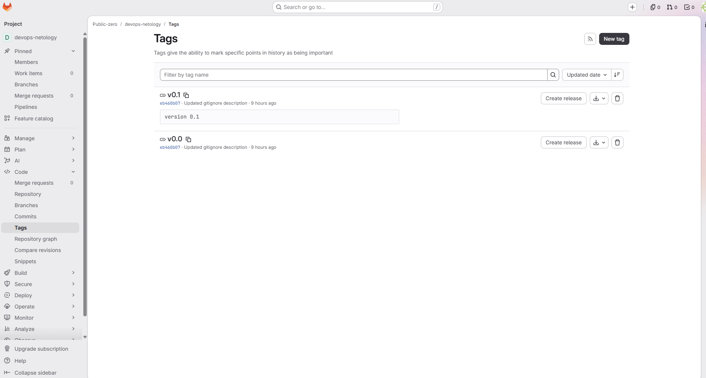

### Теги в GitHub

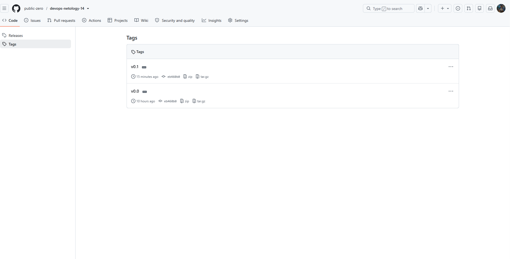

---

## Задание 3. Ветки

Сначала перешёл на ветку `main`:

```
git checkout main
```

Посмотрел историю коммитов:

```
git log --oneline
```

Нашёл нужный коммит:

```
09b477b Prepare to delete and move
```

Перешёл на этот коммит:

```
git checkout 09b477b
```

После перехода `HEAD` стал указывать непосредственно на коммит `09b477b`, а не на ветку.

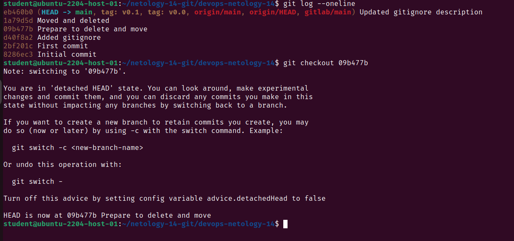

На основе этого коммита создал новую ветку `fix`:

```
git switch -c fix
```

Проверил список локальных веток:

```
git branch
```

Получил:

```
* fix
  main
```

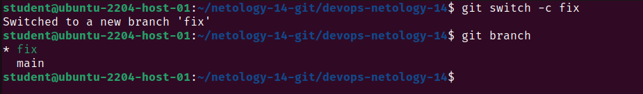

Отправил ветку `fix` в GitHub:

```
git push -u origin fix
```

После этого в GitHub появилась отдельная ветка `fix`.

Посмотрел схему веток через `Insights -> Network`.

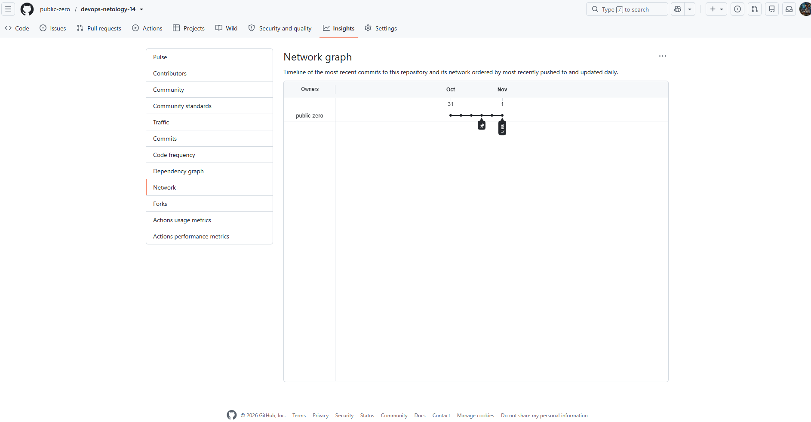

После этого в ветке `fix` добавил в файл `README.md` новую строку:

```
fix branch change
```

Добавил изменение:

```
git add README.md
```

Создал коммит:

```
git commit -m "Update README in fix branch"
```

Отправил новый коммит в ветку `fix` на GitHub:

```
git push
```

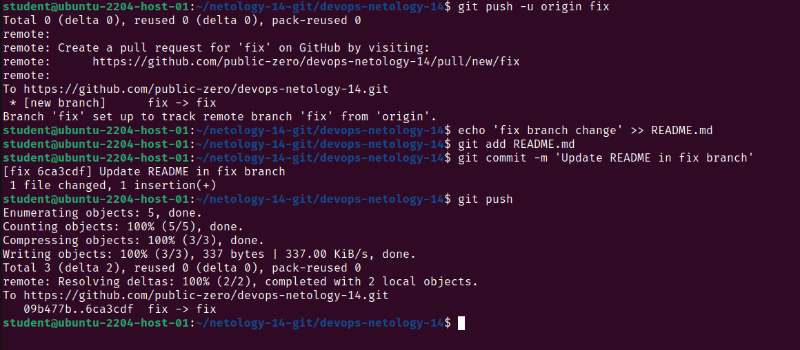

После этого посмотрел историю всех веток:

```
git log --oneline --graph --all --decorate
```

На графе видно, что ветка `fix` была создана от коммита `09b477b Prepare to delete and move`.

В ветке `fix` появился отдельный коммит `Update README in fix branch`, а ветка `main` продолжила свою историю отдельно.

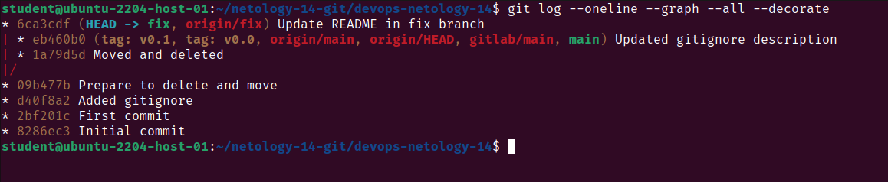

---

## Задание 4. Работа с Git через VS Code

Для выполнения задания использовал Visual Studio Code.

Сначала вернулся на ветку `main`:

```
git switch main
```

Открыл репозиторий в VS Code:

```
code .
```

В `README.md` добавил строку:

```
VS Code commit 1
```

Через окно `Source Control` добавил `README.md` в `Staged Changes`.

После этого через кнопку `Commit` создал коммит:

```
VS Code commit 1
```

Затем добавил в `README.md` вторую строку:

```
VS Code commit 2
```

Снова добавил файл в `Staged Changes` и создал второй коммит:

```
VS Code commit 2
```

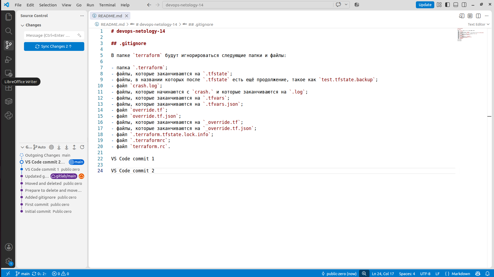

После создания двух коммитов нажал `Sync Changes`.

Локальная ветка `main` была связана с `gitlab/main`, поэтому два новых коммита были отправлены в GitLab.

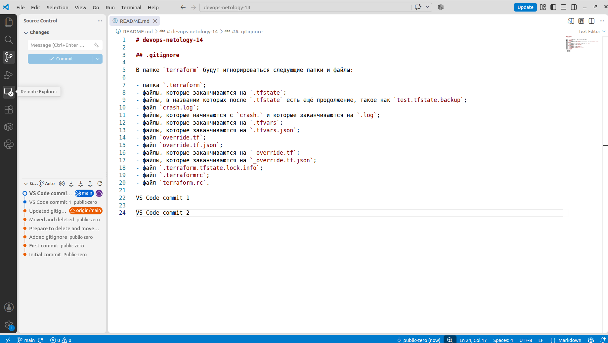

После этого отправил те же изменения в GitHub:

```
git push origin main
```

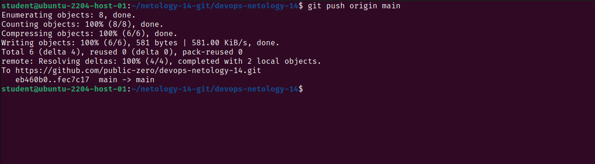

---

## Финальная проверка

После выполнения заданий проверил состояние репозитория:

```
git status
```

Проверил историю коммитов и веток:

```
git log --oneline --graph --all --decorate
```

Проверил подключённые удалённые репозитории:

```
git remote -v
```

На момент проверки:

- незакоммиченных изменений не было;
- локальная ветка `main`, `origin/main` и `gitlab/main` указывали на один последний коммит;
- в GitHub была отдельная ветка `fix`;
- GitHub был подключён как `origin`;
- GitLab был подключён как `gitlab`.

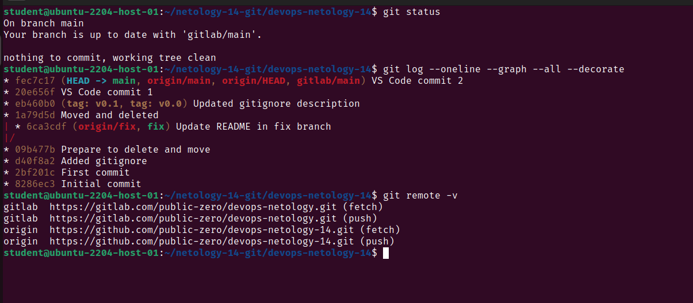

---

## Ссылки на репозитории

GitHub:

https://github.com/public-zero/devops-netology-14

GitLab:

https://gitlab.com/public-zero/devops-netology


---

## Доработка задания 3

По замечанию по заданию 3 в ветке `fix` создал дополнительный отдельный коммит:

`92667e7 Add fix branch commit`

После коммита ветка `fix` содержит два собственных коммита после ответвления от `main`.

### Коммит в ветке fix

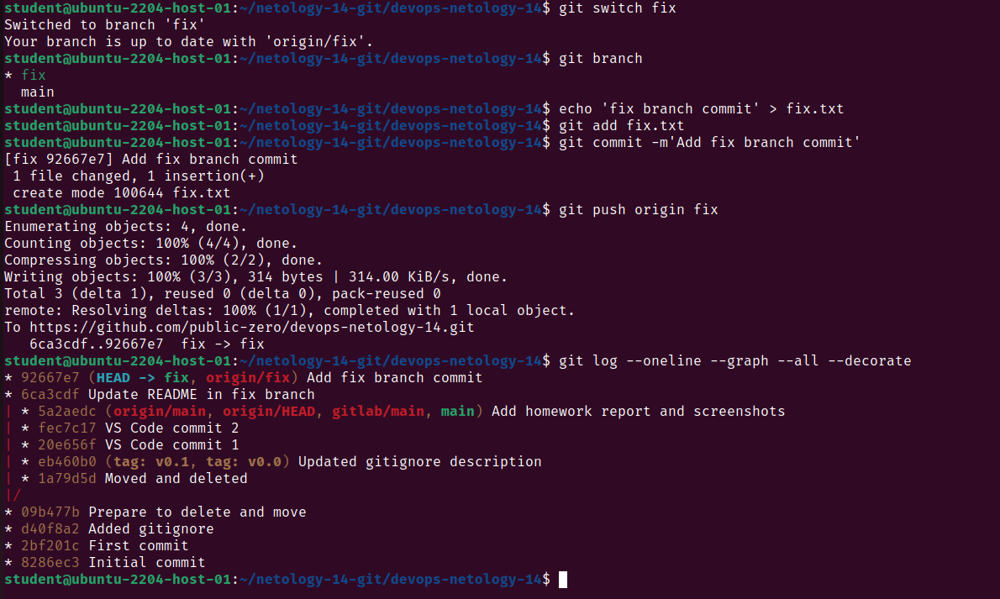

### Ветка fix в GitHub

На GitHub видно, что ветка `fix` содержит два коммита, которых нет в `main`.

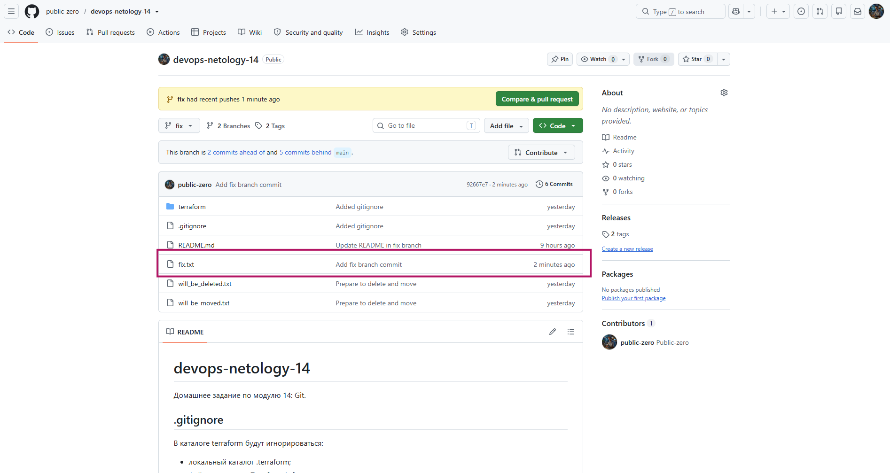
